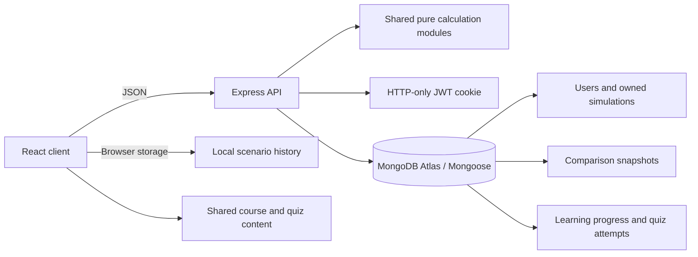

# FinCoach

FinCoach is a financial learning app for students. It provides virtual investment and fixed-deposit growth, loan, credit-card repayment, monthly budget, savings goal, and buy-versus-save simulators. Decision Replay saves a baseline and variant so you can inspect changed assumptions and compare the calculated outcomes. The app is educational; it does not provide personalised financial advice or connect to real accounts.

## Run locally

Requirements: Node.js 20.19+ (or 22.12+) and npm. From the project folder:

```sh
npm install
npm run dev
```

On Windows, double-click [`Start FinCoach.bat`](./Start%20FinCoach.bat) to start both the website and account API. Alternatively, in the VS Code terminal at the project root, use `npm.cmd install` once, then `npm.cmd run dev` (this avoids PowerShell's `npm.ps1` execution-policy error). Open the exact Vite `Local` address printed in the terminal; if 5173 is occupied Vite may select another port. Keep the terminal or batch window open while using FinCoach. Closing it stops the API, and account registration/sign-in will no longer work until the full app is started again.

The Express API runs at `http://localhost:4000`; Vite forwards `/api` requests to it. When MongoDB is not configured locally, accounts and saved scenarios use a JSON file at `server/data/fincoach-local.json`. This is for local development only; deployed accounts use MongoDB Atlas and never fall back to a temporary serverless file. For local MongoDB, copy `server/.env.example` to `server/.env`, set `MONGODB_URI` and a random `JWT_SECRET` of at least 32 characters, then restart the API. Keep `.env` files private.

```sh
npm test
npm run build
```

## What is included

- Six responsive simulators with input validation, charts, and formula/assumption breakdowns, including goal-date savings estimates and save-first versus financing cost comparisons.
- Browser-persisted scenarios and immutable, reopenable Decision Replay comparisons; account users can store comparisons on the server.
- Optional account registration and login using bcrypt password hashes and an HTTP-only session cookie.
- Profile editing, authenticated password changes, and password-confirmed account deletion, plus saved-scenario export and deletion controls.
- MongoDB models for user-owned simulations, immutable comparison snapshots, and per-user learning progress and quiz attempts.
- Public calculation endpoints for all six simulators and authenticated scenario CRUD, learning progress, and quiz-attempt endpoints.
- Search, simulator filters, and date/name sorting for scenario history.
- Eight searchable learning courses covering 70 structured modules, with knowledge checks, related simulator links, previous/next lesson navigation, a searchable book and official-resource library, reading status, and a dedicated progress view. Guest progress stays in the browser; signed-in lesson progress, server-checked quiz attempts, and reading status are stored with the account.
- Light, dark, and system display themes, a getting-started checklist, and resettable simulator inputs.

## Architecture



`shared/calculations.js` is the source of truth for calculations in both client and server. `shared/learningContent.js` supplies the lesson quiz answer key to the API so signed-in scores are computed by the server. The server recomputes submitted inputs before scenario persistence; saved results include calculation assumptions and schema version so a scenario can be explained and reproduced.

## API

| Method and path | Access | Purpose |
|---|---|---|
| `GET /api/health` | Public | API health check |
| `POST /api/simulations/:type` | Public | Calculate `investment`, `loan`, `credit-card`, `budget`, `savings-goal`, or `buy-vs-save` |
| `POST /api/auth/register` | Public | Create account and sign in |
| `POST /api/auth/login` | Public | Sign in |
| `POST /api/auth/logout` | Public | Clear session cookie |
| `GET /api/auth/me` | Signed in | Return current account |
| `PATCH /api/auth/profile` | Signed in | Update name and email |
| `PATCH /api/auth/password` | Signed in | Verify the current password and securely change it |
| `DELETE /api/auth/account` | Signed in | Verify the current password and delete the account and its saved records |
| `POST /api/simulations` | Signed in | Recompute and save a user-owned scenario |
| `GET /api/simulations` | Signed in | List the user's scenarios |
| `GET /api/simulations/:id` | Signed in | Read one owned scenario |
| `PATCH /api/simulations/:id` | Signed in | Rename one owned scenario |
| `DELETE /api/simulations/:id` | Signed in | Delete one owned scenario |
| `GET /api/learning/progress` | Signed in | Read the user's completed lessons and quiz attempts |
| `PUT /api/learning/progress` | Signed in | Replace the user's validated completed lesson list |
| `POST /api/learning/attempts` | Signed in | Server-check and save one idempotent lesson quiz attempt |
| `PUT /api/learning/reading-list` | Signed in | Save validated book reading statuses for the account |
| `POST /api/comparisons` | Signed in | Save immutable comparison snapshots |
| `PATCH /api/comparisons/:id` | Signed in | Rename one owned comparison |
| `DELETE /api/comparisons/:id` | Signed in | Delete one owned comparison |

API errors return a safe message and, where relevant, a field name. The API only returns records scoped by the authenticated owner. Authenticated history is stored in MongoDB; guest history remains in that browser's local storage.

The Learn page links to official education material from RBI, SEBI, NPCI, and the Income Tax Department. Links open the publisher's page; tax rules and product terms should be verified for the relevant date and personal circumstances.

## Calculation assumptions

- Investment without contributions uses compound interest: `A = P × (1 + r ÷ n)^(n × t)`. With monthly contributions, the simulator converts the selected nominal compounding assumption to an effective monthly rate, accrues each month, then applies the contribution at month end. Annual contribution increases apply after each completed 12 months. Rates are user-provided assumptions, not forecasts.
- The loan uses the standard fixed-rate EMI formula, converts nominal annual interest to a monthly rate by dividing by 12, and handles a zero-rate loan separately. Totals use unrounded values.
- The credit-card model converts APR to a monthly rate using APR ÷ 12, adds optional new spending to the opening balance, applies interest before payment, and uses the same payment each month. Fees are not modeled. The payment must exceed accrued interest and clear the balance within 600 months. This is not any issuer's exact minimum-payment method.
- The budget planner totals virtual allocations. An over-allocation is highlighted; savings rate is the savings category divided by monthly income.
- The savings goal planner adds end-of-month contributions and monthly interest (annual rate ÷ 12), projects the balance to the target date, and solves for the contribution needed by that date. It caps projections at 50 years.
- The purchase comparison assumes full-price financing with fixed amortized payments, separate user-entered processing fees, and no other charges. Save-first assumes no interest and monthly deposits until the purchase price is available.
- All monetary values are illustrative and exclude tax/fees unless explicitly shown.

## Academic project package

Capture interface screenshots, sample inputs/results, test evidence, and the architecture above during development. Use the current department report format and confirm its certificate wording, reference rules, training acceptance, and submission deadline with faculty before finalising those materials. The workspace includes the provided report-format and project-requirements documents as references.

## Deployment

### Vercel (configured)

The root `index.js` exports the Express app as a Vercel Function. `npm run build` builds the Vite client and copies the static bundle into `public/`, while the Express app serves the SPA fallback and handles `/api/*` requests on the same origin. This keeps the HTTP-only session cookie same-origin and avoids a separately hosted local API. Vercel's current Express flow supports exporting an Express app from the project root and serving static assets from `public/` ([Express deployment guide](https://vercel.com/kb/guide/ship-a-express-app-on-vercel), [Vercel Functions](https://vercel.com/docs/functions)).

1. Push the project to GitHub and import that repository at [Vercel New Project](https://vercel.com/new). Set the project root to the repository root and build command to `npm run build`; leave the output directory on automatic detection.
2. Create a MongoDB Atlas database and allow the deployed function to connect to it. In Vercel Project Settings → Environment Variables, add `MONGODB_URI` (Atlas connection string) and `JWT_SECRET` (a private random value with at least 32 characters) for Production and Preview. Never use a `VITE_` prefix for secrets.
3. Deploy, then open `/api/health` on the deployed domain. A healthy account service returns `{"status":"ok","storage":"mongodb"}`. `{"status":"misconfigured"...}` means `MONGODB_URI` or `JWT_SECRET` is missing or invalid; `{"status":"unavailable","storage":"mongodb"}` means the function could not connect to Atlas. For the latter, verify the Atlas database username/password in the URI, the database name, and Atlas Network Access rules. Make sure both variables are enabled for the environment you are testing (Production or Preview), then redeploy after changing them. Do not share the URI or secret publicly. Create an account and save/reopen a scenario to confirm persistence. A production deployment without valid database and secret settings leaves accounts unavailable rather than storing account records in an ephemeral function filesystem.

Vercel publishes the website independently of a local terminal; deployments update when new commits are pushed to the connected Git branch. The production website and its database still depend on the selected hosting/database plans and their availability.

### Netlify

The repository includes `netlify.toml` and a `serverless-http` function adapter. Netlify serves the Vite build from `client/dist` and rewrites same-origin `/api/*` requests to the Express function. This follows Netlify's [Express deployment guide](https://docs.netlify.com/build/frameworks/framework-setup-guides/express/).

1. Import the repository from GitHub into Netlify. Set the base directory to the repository root; the included `netlify.toml` supplies `npm run build`, the publish directory, function directory, and API/SPA rewrites.
2. Create the MongoDB Atlas database. In Netlify Project configuration → Environment variables, add `MONGODB_URI` and a private random `JWT_SECRET` of at least 32 characters. Ensure both are available to Functions and the Production/Deploy Preview contexts you use. Never put secrets in `netlify.toml` or a `VITE_` variable.
3. Deploy and open `/api/health` on the Netlify site. Expect `{"status":"ok","storage":"mongodb"}` before registering. `misconfigured` means one of the two variables is absent or invalid; `unavailable` means the function cannot connect to Atlas, so check the connection string, database user credentials, database name, and Atlas network access. Changing environment variables requires a new deploy ([Netlify environment variables for Functions](https://docs.netlify.com/build/functions/environment-variables/)).

Netlify runs Express as an on-demand serverless function, so it does not need a local API process to stay open. MongoDB Atlas remains required for persistent hosted accounts; the local JSON store is only for local development.
