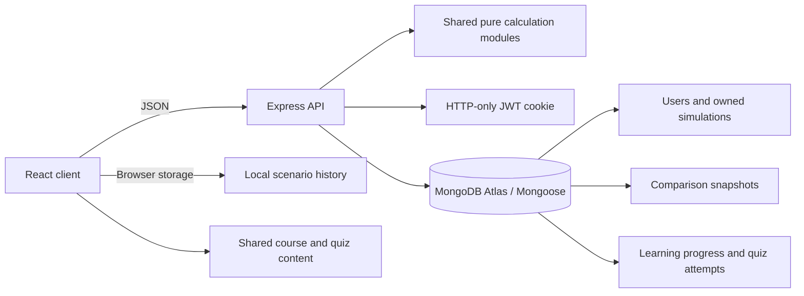

# FinCoach

FinCoach is a financial learning app for students. It provides virtual investment and fixed-deposit growth, loan, credit-card repayment, monthly budget, savings goal, and buy-versus-save simulators. Decision Replay saves a baseline and variant so you can inspect changed assumptions and compare the calculated outcomes. The app is educational; it does not provide personalised financial advice or connect to real accounts.

## Run locally

Requirements: Node.js 20.19+ (or 22.12+) and npm. From the project folder:

```sh
npm install
npm run dev
```

On Windows, double-click [`Start FinCoach.bat`](./Start%20FinCoach.bat) to start both the website and account API. Alternatively, in the VS Code terminal at the project root, use `npm.cmd install` once, then `npm.cmd run dev` (this avoids PowerShell's `npm.ps1` execution-policy error). Open `http://localhost:5173/`. FinCoach uses this fixed port so the browser URL cannot silently drift; if Vite reports that the port is busy, stop the older FinCoach terminal with `Ctrl+C` and run the command again. Keep the terminal or batch window open while using FinCoach. Closing it stops both processes; after changing server code, restart the command to load those changes.

The Express API runs at `http://localhost:4000`; Vite forwards `/api` requests to it. The API loads `server/.env` explicitly, including when started from the repository root. When MongoDB is not configured locally, accounts and saved scenarios use a JSON file at `server/data/fincoach-local.json`. This is for local development only; production startup requires `MONGODB_URI`, and production API requests never fall back to local JSON. For local MongoDB, copy `server/.env.example` to `server/.env`, set `MONGODB_URI` and a random `JWT_SECRET` of at least 32 characters, then restart the API. Keep `.env` files private.

```sh
npm test
npm run build
```

`npm test` runs the API/calculation suite and the client interaction suite. The API tests cover registration, duplicate accounts, password hashing, login, persistent sessions, profile and password changes, password-confirmed account deletion and owned-data cleanup, simulator validation, owner checks, and hosted configuration errors. The client tests exercise registration, login, password visibility, session restoration, profile updates and account creation date, real progress data in Settings, recovery from malformed browser storage, theme persistence, correct-quiz progress persistence across reloads, every lesson-module link, and a baseline-to-variant Decision Replay through the UI, including saving its version history. They also cover My progress links and the Student workspace return-to-Overview control. The production build compiles the client and prepares the Vercel static assets.

GitHub Actions runs the frozen pnpm workspace install, the full test suite, and the production build on pushes to `main`, pull requests, and manual runs. Its workflow is at `.github/workflows/ci.yml`.

### Latest verification (11 November 2026)

- `npm test`: passed — 31 server/API, calculation, and configuration tests plus 19 client interaction tests (50 total), including navigation through all 70 lessons, the Student workspace, guest progress migration, the editable card minimum-payment comparison, expired-session messaging, keyboard operation of the account dialog, and logout failure handling.
- `npm run build`: passed — Vite production bundle generated and the Vercel static assets prepared.
- Local startup check: the combined dev command served the frontend and proxied `/api/health` successfully; stopping it released its API/frontend listeners.
- Netlify adapter test: the automated test invokes the function handler and confirms the simulator response. Netlify CLI `build` also completed locally, including bundling `api.mjs`; a hosted Netlify deployment has not been verified here.
- `pnpm audit --prod`: passed with no known production dependency vulnerabilities after upgrading Mongoose and pinning the patched `body-parser` release.
- Fresh CI-style pnpm install: passed with frozen lockfile and the approved esbuild postinstall script.
- Account persistence was verified against the local development JSON store. A live MongoDB Atlas connection and the deployed Netlify/Vercel environment were not available for verification; hosted accounts require valid `MONGODB_URI` and `JWT_SECRET` values, as described below.

## What is included

- Six responsive simulators with input validation, charts, and formula/assumption breakdowns, including an adjustable educational credit-card minimum-payment estimate, goal-date savings estimates, and save-first versus financing cost comparisons.
- Browser-persisted scenarios and immutable, reopenable Decision Replay comparisons; account users can store comparisons on the server.
- Decision Replay keeps an append-only version timeline for each comparison, including input changes, notes, timestamps, and server-recomputed result snapshots. The baseline remains fixed while new assumptions are replayed.
- Optional account registration and login using bcrypt password hashes and an HTTP-only session cookie.
- Profile editing, authenticated password changes, and password-confirmed account deletion, plus saved-scenario export and deletion controls.
- MongoDB models for user-owned simulations, immutable comparison snapshots, and per-user learning progress and quiz attempts.
- Public calculation endpoints for all six simulators and authenticated scenario CRUD, learning progress, and quiz-attempt endpoints.
- Search, simulator filters, and date/name sorting for scenario history.
- Eight searchable learning courses covering 70 topic-specific modules, with individual lesson checks, previous/next navigation, and one four-question course-end assessment per course. The 32 assessment questions include multiple-choice, true/false, scenario, and calculation formats with explanations; authenticated scores are recomputed by the API. Supplementary lesson material and checks live in `shared/supplementalLessons.js` instead of repeating a generic course paragraph. The book and official-resource library is searchable, and reading status and learning progress are tracked.
- Light, dark, and system display themes, a getting-started checklist, and resettable simulator inputs.

## Architecture



`shared/calculations.js` is the source of truth for calculations in both client and server. `shared/learningContent.js` assembles each course from its core lessons and the topic-specific `shared/supplementalLessons.js` content. Lesson checks and `shared/courseAssessments.js` supply assessment keys to the API, so signed-in scores are recomputed server-side. The server recomputes submitted inputs before scenario persistence; saved results include calculation assumptions and schema version so a scenario can be explained and reproduced.

### Data model

- `User`: display name, normalized unique email, and a bcrypt password hash excluded from normal queries and API responses.
- `Simulation`: owner ID, simulator type, title, calculation schema version, original inputs, assumptions, and recomputed results. User and update-time indexes support private history lookups.
- `Comparison`: owner ID, baseline and variant snapshots, and append-only replay versions with changed inputs, notes, and timestamps.
- `LearningProgress`: one record per user containing completed lesson IDs, quiz-attempt snapshots, and book-reading statuses.

There are no seeded demo credentials. For a local demonstration, start the app and register through the account form; local development stores those records in the private JSON development store unless MongoDB is configured. For a hosted demonstration, first verify `/api/health` reports MongoDB, then register a dedicated demo account. Do not commit or share its password.

## API

See [API reference](docs/api.md) for request bodies, authentication, response shapes, status codes, and examples.

| Method and path | Access | Purpose |
|---|---|---|
| `GET /api/health` | Public | API health check |
| `POST /api/simulations/:type` | Public | Calculate `investment`, `loan`, `credit-card`, `budget`, `savings-goal`, or `buy-vs-save` |
| `POST /api/auth/register` | Public | Create account and sign in |
| `POST /api/auth/login` | Public | Sign in |
| `POST /api/auth/logout` | Public | Clear session cookie |
| `GET /api/auth/me` | Signed in | Return current account |
| `PATCH /api/auth/profile` | Signed in | Update name and email |
| `PATCH /api/auth/password` | Signed in | Verify the current password and securely change it |
| `DELETE /api/auth/account` | Signed in | Verify the current password and delete the account and its saved records |
| `POST /api/simulations` | Signed in | Recompute and save a user-owned scenario |
| `GET /api/simulations` | Signed in | List the user's scenarios |
| `GET /api/simulations/:id` | Signed in | Read one owned scenario |
| `PATCH /api/simulations/:id` | Signed in | Rename one owned scenario |
| `DELETE /api/simulations/:id` | Signed in | Delete one owned scenario |
| `GET /api/learning/progress` | Signed in | Read the user's completed lessons and quiz attempts |
| `PUT /api/learning/progress` | Signed in | Replace the user's validated completed lesson list |
| `POST /api/learning/attempts` | Signed in | Server-check and save one idempotent lesson quiz attempt |
| `POST /api/learning/assessments/:assessmentId/attempts` | Signed in | Re-grade submitted choices against the shared question bank and save one idempotent course assessment |
| `PUT /api/learning/reading-list` | Signed in | Save validated book reading statuses for the account |
| `POST /api/comparisons` | Signed in | Save immutable comparison snapshots |
| `GET /api/comparisons` | Signed in | List the user's comparisons and replay versions |
| `GET /api/comparisons/:id/versions` | Signed in | Retrieve version history for one owned comparison |
| `POST /api/comparisons/:id/versions` | Signed in | Recompute inputs server-side and append an immutable replay version |
| `PATCH /api/comparisons/:id` | Signed in | Rename one owned comparison |
| `DELETE /api/comparisons/:id` | Signed in | Delete one owned comparison |

API errors return a safe message and, where relevant, a field name. The API only returns records scoped by the authenticated owner. Authenticated history is stored in MongoDB; guest history remains in that browser's local storage.

Registration and login are limited to 10 requests per 15 minutes for each client IP and route. The counter is held in process memory, so separate serverless instances do not share it; enable the hosting provider's edge/WAF rate limiting for stronger production-wide enforcement.

The Learn page links to official education material from RBI, SEBI, NPCI, and the Income Tax Department. Links open the publisher's page; tax rules and product terms should be verified for the relevant date and personal circumstances.

## Calculation assumptions

- Investment without contributions uses compound interest: `A = P × (1 + r ÷ n)^(n × t)`. With monthly contributions, the simulator converts the selected nominal compounding assumption to an effective monthly rate, accrues each complete month, then applies the contribution at month end. A fractional final month accrues proportionally without adding an early contribution. Annual contribution increases apply after each completed 12 months. Rates are user-provided assumptions, not forecasts.
- The loan uses the standard fixed-rate EMI formula, converts nominal annual interest to a monthly rate by dividing by 12, and handles a zero-rate loan separately. Totals use unrounded values.
- The credit-card model converts APR to a monthly rate using APR ÷ 12, adds optional new spending to the opening balance, and applies interest before payment. It compares a fixed higher payment with an adjustable educational minimum estimate (percentage of amount due or a rupee floor, whichever is greater). The estimate is not any issuer's minimum-payment rule. Fees are not modeled; the higher fixed payment must exceed accrued interest and clear the balance within 600 months.
- The budget planner totals virtual allocations. An over-allocation is highlighted; savings rate is the savings category divided by monthly income.
- The savings goal planner adds end-of-month contributions and monthly interest (annual rate ÷ 12). A target-date projection counts only month ends on or before the selected date; if there is no deposit date before the target, the required monthly amount is shown as unavailable. The estimated completion date is the exact month end of the corresponding deposit period. It caps projections at 50 years.
- Monetary simulator inputs are capped at ₹1,000,000,000,000 and budget category count at 100 so extreme inputs cannot silently produce non-finite outputs. Numeric fields reject booleans, arrays, blank strings, and other non-number values.
- The purchase comparison assumes full-price financing with fixed amortized payments, separate user-entered processing fees, and no other charges. Save-first assumes no interest and monthly deposits until the purchase price is available.
- All monetary values are illustrative and exclude tax/fees unless explicitly shown.

## Academic project package

The repository contains the source, setup and API documentation, architecture diagram, formula assumptions, and automated test instructions. Add approved interface screenshots and sample calculation evidence to the final submission. The department report template and project-requirements documents were not present in this checkout, so use the current approved department format and confirm certificate wording, reference rules, training acceptance, and deadline with faculty before submitting. Do not treat this README as a substitute for those academic approvals.

## Deployment

### Vercel (configured)

The root `index.js` exports the Express app as a Vercel Function. `npm run build` builds the Vite client and copies the static bundle into `public/`, while the Express app serves the SPA fallback and handles `/api/*` requests on the same origin. This keeps the HTTP-only session cookie same-origin and avoids a separately hosted local API. Vercel's current Express flow supports exporting an Express app from the project root and serving static assets from `public/` ([Express deployment guide](https://vercel.com/kb/guide/ship-a-express-app-on-vercel), [Vercel Functions](https://vercel.com/docs/functions)).

1. Push the project to GitHub and import that repository at [Vercel New Project](https://vercel.com/new). Set the project root to the repository root and build command to `npm run build`; leave the output directory on automatic detection.
2. Create a MongoDB Atlas database and allow the deployed function to connect to it. In Vercel Project Settings → Environment Variables, add `MONGODB_URI` (Atlas connection string) and `JWT_SECRET` (a private random value with at least 32 characters) for Production and Preview. Never use a `VITE_` prefix for secrets.
3. Deploy, then open `/api/health` on the deployed domain. A healthy account service returns `{"status":"ok","storage":"mongodb"}`. `{"status":"misconfigured"...}` means `MONGODB_URI` or `JWT_SECRET` is missing or invalid; `{"status":"unavailable","storage":"mongodb"}` means the function could not connect to Atlas. For the latter, verify the Atlas database username/password in the URI, the database name, and Atlas Network Access rules. Make sure both variables are enabled for the environment you are testing (Production or Preview), then redeploy after changing them. Do not share the URI or secret publicly. Create an account and save/reopen a scenario to confirm persistence. A production deployment without valid database and secret settings leaves accounts unavailable rather than storing account records in an ephemeral function filesystem.

Vercel publishes the website independently of a local terminal; deployments update when new commits are pushed to the connected Git branch. The production website and its database still depend on the selected hosting/database plans and their availability.

### Netlify

The repository includes `netlify.toml` and a `serverless-http` function adapter. Netlify serves the Vite build from `client/dist` and rewrites same-origin `/api/*` requests to the Express function. This follows Netlify's [Express deployment guide](https://docs.netlify.com/build/frameworks/framework-setup-guides/express/).

1. Import the repository from GitHub into Netlify. Set the base directory to the repository root; the included `netlify.toml` supplies `npm run build`, the publish directory, function directory, and API/SPA rewrites.
2. Create the MongoDB Atlas database. In Netlify Project configuration → Environment variables, add `MONGODB_URI` and a private random `JWT_SECRET` of at least 32 characters. Ensure both are available to Functions and the Production/Deploy Preview contexts you use. Never put secrets in `netlify.toml` or a `VITE_` variable.
3. Deploy and open `/api/health` on the Netlify site. Expect `{"status":"ok","storage":"mongodb"}` before registering. `misconfigured` means one of the two variables is absent or invalid; `unavailable` means the function cannot connect to Atlas, so check the connection string, database user credentials, database name, and Atlas network access. Changing environment variables requires a new deploy ([Netlify environment variables for Functions](https://docs.netlify.com/build/functions/environment-variables/)).

If the site or `/api/health` returns HTTP 401 with a Netlify Edge Access login page, the request is being blocked before it reaches FinCoach. Check Project configuration → General → Visitor access and Project visibility for the Production deploy. For a public demo, Production must allow public visitors; access restrictions can remain on preview deploys if desired. This gate is separate from FinCoach account registration ([Netlify site access controls](https://docs.netlify.com/manage/security/secure-access-to-sites/password-protection/)).

Netlify runs Express as an on-demand serverless function, so it does not need a local API process to stay open. MongoDB Atlas remains required for persistent hosted accounts; the local JSON store is only for local development.
