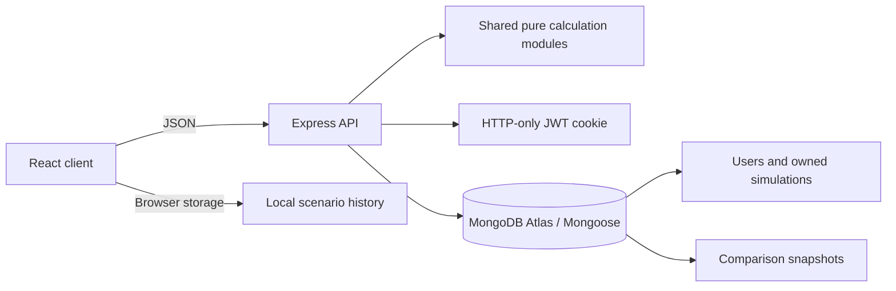

# FinCoach

FinCoach is a financial learning app for students. It provides virtual investment and fixed-deposit growth, loan, credit-card repayment, and monthly budget simulators. Decision Replay saves a baseline and variant so you can inspect changed assumptions and compare the calculated outcomes. The app is educational; it does not provide personalised financial advice or connect to real accounts.

## Run locally

Requirements: Node.js 20.19+ (or 22.12+) and npm. From the project folder:

```sh
npm install
npm run dev
```

Open the Vite address printed by the client process (normally `http://localhost:5173`). The Express API runs at `http://localhost:4000`; Vite forwards `/api` requests to it. Without MongoDB configured, accounts and saved scenarios use a local JSON store at `server/data/fincoach-local.json`, so you can create an account and use the app locally. This file is ignored by Git. For deployment or shared multi-device accounts, copy `server/.env.example` to `server/.env`, set a MongoDB Atlas connection string and a random `JWT_SECRET` with at least 32 characters, then restart the API. Keep `.env` files private.

```sh
npm test
npm run build
```

## What is included

- Four responsive simulators with input validation, charts, and formula/assumption breakdowns.
- Browser-persisted scenarios and immutable, reopenable Decision Replay comparisons; account users can store comparisons on the server.
- Optional account registration and login using bcrypt password hashes and an HTTP-only session cookie.
- Profile editing, authenticated password changes, and password-confirmed account deletion, plus saved-scenario export and deletion controls.
- MongoDB models for user-owned simulations and immutable comparison snapshots.
- Public calculation endpoints and authenticated scenario CRUD endpoints.
- Search, simulator filters, and date/name sorting for scenario history.
- Four interactive financial lessons with quizzes and browser-saved completion progress, plus FAQ and educational-use notices.
- Light, dark, and system display themes, a getting-started checklist, and resettable simulator inputs.

## Architecture



`shared/calculations.js` is the source of truth for calculations in both client and server. The server recomputes submitted inputs before persistence; saved results include the calculation assumptions and schema version so a scenario can be explained and reproduced.

## API

| Method and path | Access | Purpose |
|---|---|---|
| `GET /api/health` | Public | API health check |
| `POST /api/simulations/:type` | Public | Calculate `investment`, `loan`, `credit-card`, or `budget` |
| `POST /api/auth/register` | Public | Create account and sign in |
| `POST /api/auth/login` | Public | Sign in |
| `POST /api/auth/logout` | Public | Clear session cookie |
| `GET /api/auth/me` | Signed in | Return current account |
| `PATCH /api/auth/profile` | Signed in | Update name and email |
| `PATCH /api/auth/password` | Signed in | Verify the current password and securely change it |
| `DELETE /api/auth/account` | Signed in | Verify the current password and delete the account and its saved records |
| `POST /api/simulations` | Signed in | Recompute and save a user-owned scenario |
| `GET /api/simulations` | Signed in | List the user's scenarios |
| `GET /api/simulations/:id` | Signed in | Read one owned scenario |
| `PATCH /api/simulations/:id` | Signed in | Rename one owned scenario |
| `DELETE /api/simulations/:id` | Signed in | Delete one owned scenario |
| `POST /api/comparisons` | Signed in | Save immutable comparison snapshots |
| `PATCH /api/comparisons/:id` | Signed in | Rename one owned comparison |
| `DELETE /api/comparisons/:id` | Signed in | Delete one owned comparison |

API errors return a safe message and, where relevant, a field name. The API only returns records scoped by the authenticated owner. Authenticated history is stored in MongoDB; guest history remains in that browser's local storage.

## Calculation assumptions

- Investment growth uses compound interest: `A = P × (1 + r ÷ n)^(n × t)`. Rates are user-provided assumptions, not forecasts.
- The loan uses the standard fixed-rate EMI formula, converts nominal annual interest to a monthly rate by dividing by 12, and handles a zero-rate loan separately. Totals use unrounded values.
- The credit-card model converts APR to a monthly rate using APR ÷ 12, adds interest before payment, uses the same payment each month, and assumes no new purchases or fees. The payment must exceed accrued interest and clear the balance within 600 months. This is not any issuer's exact minimum-payment method.
- The budget planner totals virtual allocations. An over-allocation is highlighted; savings rate is the savings category divided by monthly income.
- All monetary values are illustrative and exclude tax/fees unless explicitly shown.

## Academic project package

Capture interface screenshots, sample inputs/results, test evidence, and the architecture above during development. Use the current department report format and confirm its certificate wording, reference rules, training acceptance, and submission deadline with faculty before finalising those materials. The workspace includes the provided report-format and project-requirements documents as references.

## Deployment

Build the client with `npm run build`. Deploy the `client/dist` static output and the Node server separately, set `CLIENT_ORIGIN`, `MONGODB_URI`, and a strong `JWT_SECRET` in the server environment, and enable HTTPS. Check provider free-tier limits before choosing a host. Keep the local demo as a fallback.
